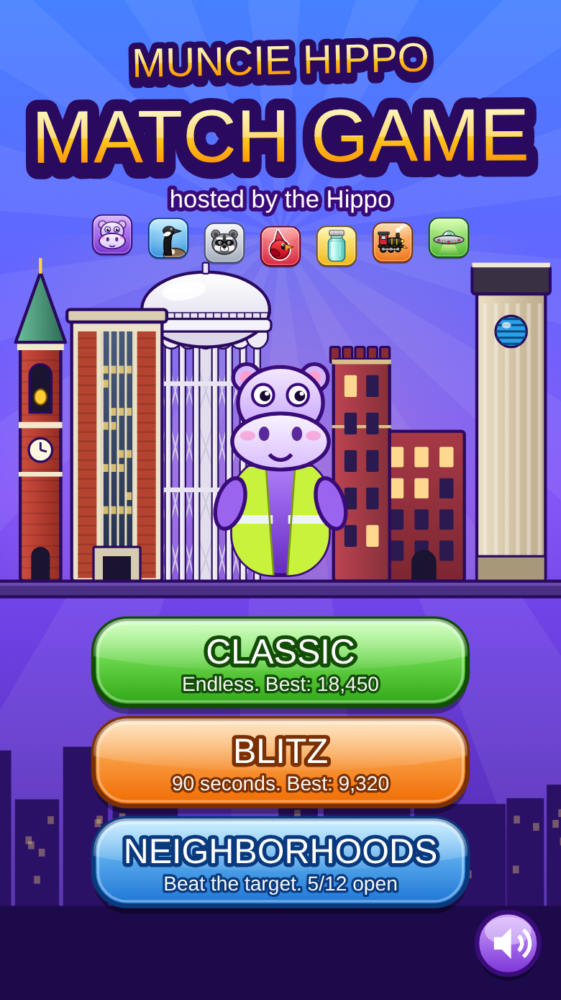
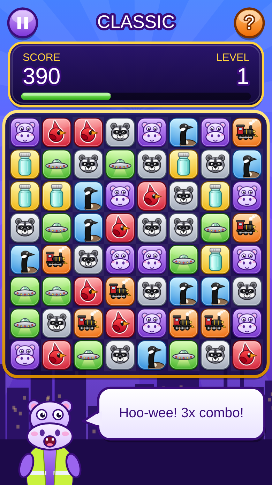
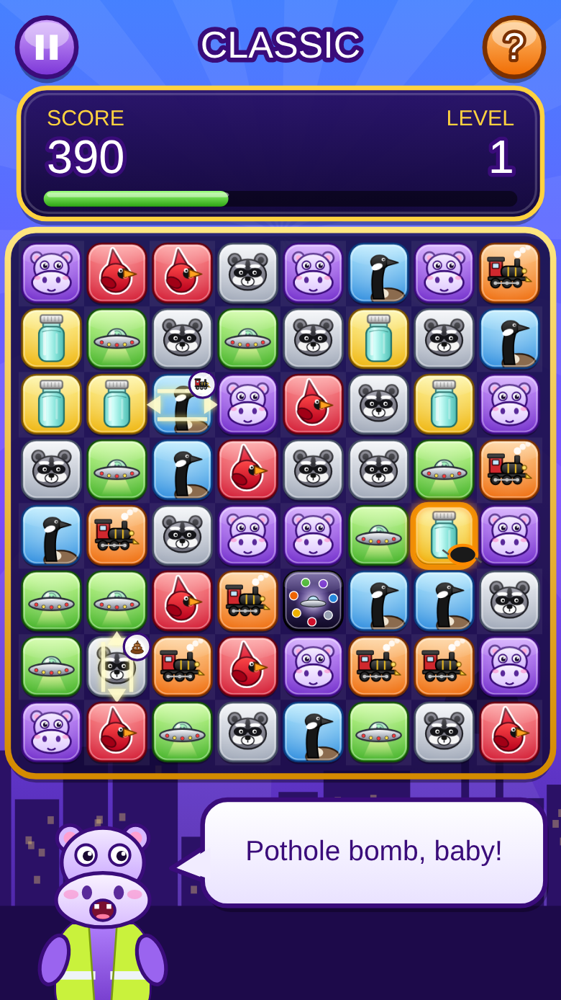
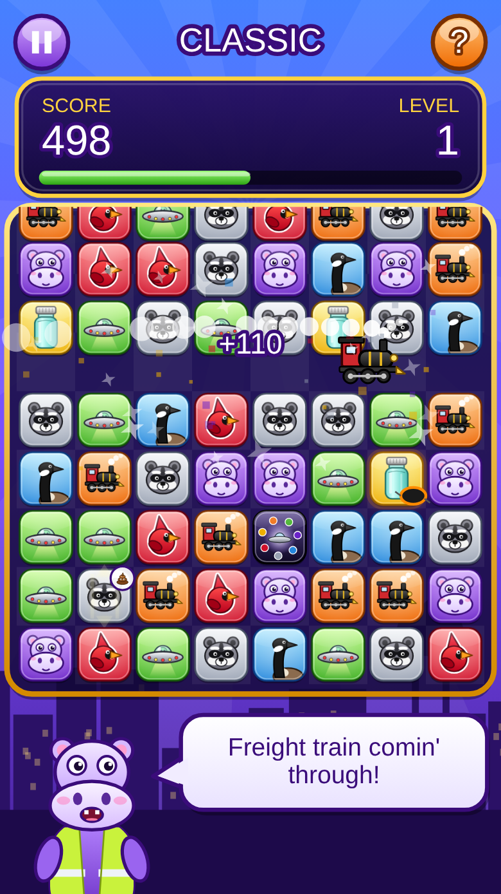
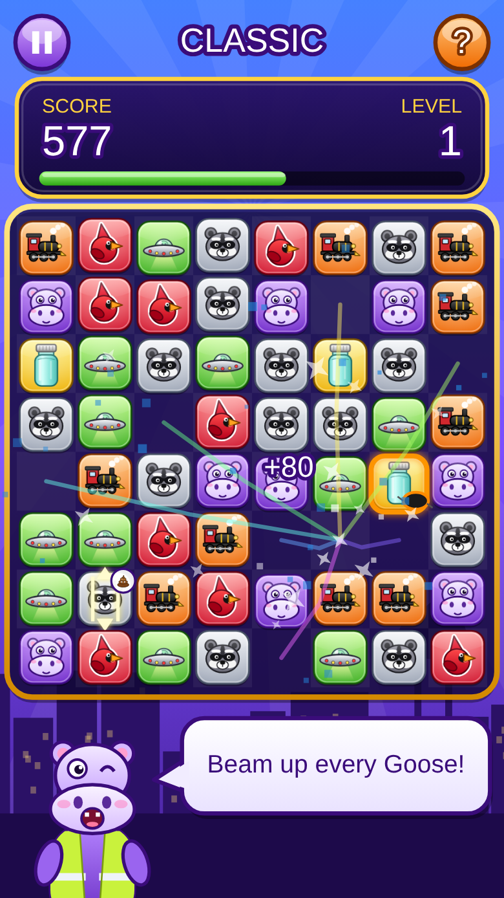
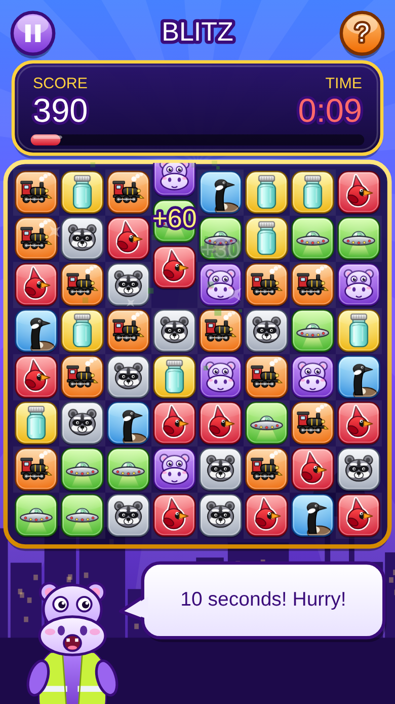
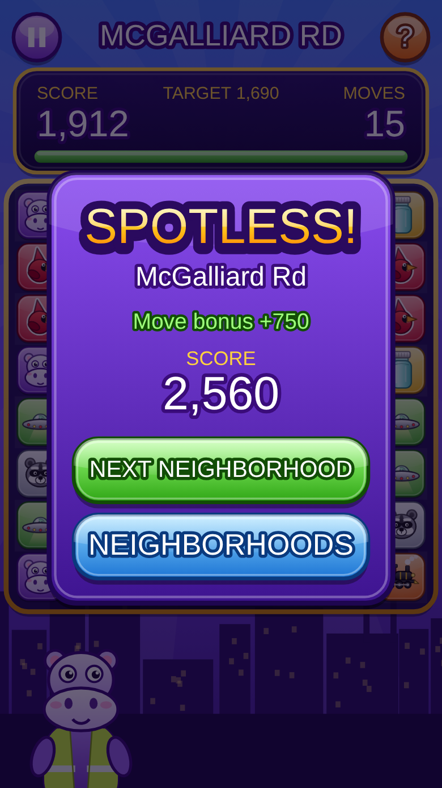
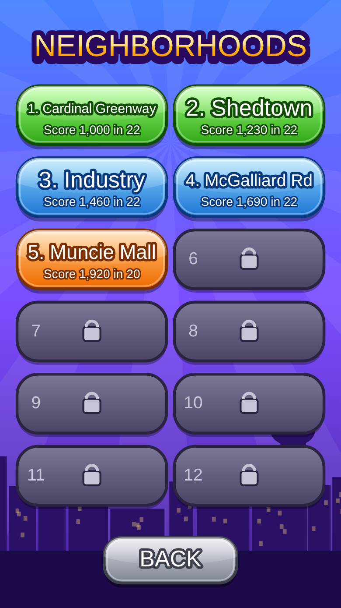

# Muncie Hippo: Match Game

A match-3 puzzle game for phones, hosted by the purple hippo from Muncie Hippo Hole Patrol. Swap tiles to line up hippos, Canada geese, raccoons, cardinals, Ball jars, trains and UFOs, set off themed power-ups, and clean up the neighborhoods of Muncie, Indiana.

**Play it:** https://andyshearsphd.github.io/MuncieMatch/ (best on a phone, or open `index.html` in any modern browser).

## Screenshots

| | |
|---|---|
|  |  |
| A Classic game in progress | Power-ups waiting on the board |
|  |  |
| The Freight Train clearing a row | The Mothership beaming up every Ball jar |
|  |  |
| Blitz mode with the clock running down | A neighborhood cleaned up |

## How to play

- **Swipe** a tile into a neighbor to swap them, or **tap** two neighboring tiles.
- Line up 3 or more of the same tile to clear them. Falling tiles can set off chain combos for bigger points.
- Stuck? Tap the **?** button for a hint. One also appears on its own after 10 seconds.
- The pause button has Resume, Restart, Menu and sound on/off.

## Power-ups

- **Freight Train** (4 in a row across): a train races along the row and clears it
- **Hippo Drop** (4 in a row up and down): a poop falls down the column and clears it
- **Pothole Bomb** (an L or T shape): clears everything around it
- **Mothership** (5 in a row): swap it with any tile to beam up every tile of that kind

## Modes

- **Classic:** endless play. Level up as your score climbs. The game ends when no moves are left.
- **Blitz:** 90 seconds on the clock. Every power-up you make adds 2 seconds.
- **Neighborhoods:** 12 levels across Muncie, from Cardinal Greenway and Shedtown to the Muncie Mall, Minnetrista Blvd and Downtown. Hit the target score before you run out of moves. Moves you don't use become bonus points.

## Features

- Glossy tiles and buttons in the style of a 2010 iPhone game
- The purple hippo cheers your combos, winks at the big moves and gives tips
- A title-screen skyline with the AT&T building, Cornerstone, Ball State's Teachers College and bell tower, and the big downtown water tower
- Sound effects, best scores and saved neighborhood progress

## Notes

Everything is in one self-contained HTML file. Graphics and sound are generated in code; the only outside file is a Google font.
